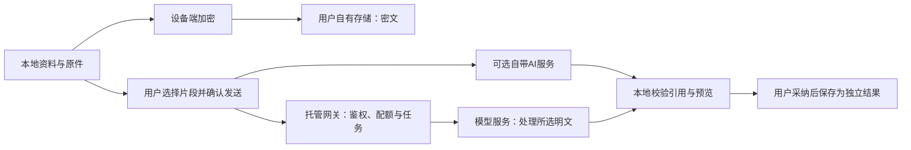

# 云服务与云端 AI 技术方案

更新：2026-10-22。状态：设计，未实现。当前1.1.0无互联网权限、无账号、无自动云同步、无模型调用。方案同时支持团队托管的收费云AI服务和可选自带服务，商业用途、套餐与成本见[云AI商业方案](CLOUD_AI_BUSINESS.md)。

## 能力分工

| 能力 | 本地负责 | 可选服务负责 | 必须保持的边界 |
| --- | --- | --- | --- |
| 阅读、书写、规则整理、复习 | 全部核心流程和事实源 | 无依赖 | 关闭网络／云能力不阻止使用 |
| 加密副本与后续同步 | 密钥、加解密、操作日志、冲突处理、恢复 | 用户自有 WebDAV／S3／兼容对象存储，仅存密文 | 不建中心学习账号；副本、同步、恢复分别验收 |
| 托管云AI | 片段选择、发送预览、引用验证、人工确认 | 团队网关、任务队列、检索适配、模型路由、点数账本与供应商调用 | 不向客户端发放供应商主密钥，服务端实施配额；未实现 |
| 自带AI服务 | 片段选择、凭据引用、结果验证 | 用户自选推理API或自托管端点 | 独立计费与数据说明，不计作团队托管服务收入 |
| 静态帮助与隐私网页 | 展示与链接 | 公共静态托管 | 不承载用户学习数据 |
| 收费云盘网站与公开资料库 | 当前采用用户下载后主动导入；后续可选连接 | 网站账号、订单、配额、私有权限、授权公开目录 | 网站身份独立；公开库与私人空间隔离，尚未实现 |

华为云 OBS／MaaS 可作为候选，未选定采购、区域、模型或接口版本。对象存储协议兼容性必须实测，不因名称含“S3 兼容”就承诺全部接口可用。[OBS 官方计费说明](https://support.huaweicloud.com/intl/zh-cn/price-obs/obs_42_0001.html)、[MaaS 官方计费说明](https://support.huaweicloud.com/price-maas/price-maas-0001.html)。

## 两条独立的数据流

传输使用 HTTPS 保护链路，不等于推理供应商无法读取输入。应用加密副本路径要求端到端加密；普通云端 AI 路径是经用户同意的明文推理，输入保留、训练用途、处理地区和删除能力取决于实际供应商条款，必须逐项核验并向用户说明。收费网站若提供普通网页上传及在线预览，会处理相应明文，不能沿用加密副本的宣传；公开资料需有公开授权。三种存储边界见[网站方案](WEB_PLATFORM_PLAN.md)。当前隐私政策仍只描述本地版，接入前必须同步更新权限与所有隐私生成物。

## 云存储设计约束

- RDB 为本地事实源；同步层通过独立端口读取已提交快照或操作日志，不直接改 UI 状态。CRDT／版本向量为待评估方案，尚未实现。
- 密钥由设备安全能力保护；HUKS 可支持的算法和导入方式须按目标设备验证。文档中的 Ed25519／X25519 为候选，不视作设备能力保证。密钥恢复先完成离线演练，再开放跨设备同步。
- 对象键不能暴露笔记标题、标签和文件名；正文、附件及同步元数据均加密。密文仍可能暴露对象大小、时间与访问模式，不宣传“零元数据泄漏”。
- 上传队列记录内容摘要、操作 ID、重试次数和版本；按目标端点核验条件写、版本和分页语义，不能用时间戳粗暴覆盖冲突。删除用墓碑传播，离线旧设备重连不得复活已删资料。
- 附件分块、断点恢复和完整性校验独立验收。端点失效、配额耗尽和凭据撤销不删除本机原件；保留可重试任务。
- 恢复密钥不由团队托管，不承诺客服找回。导出恢复材料前明确其敏感性；现有备份仍是明文，不把未来加密方案套用到当前导出文件。

## 云端 AI 的本地端口契约

这是内部用例契约，不能当作已上线 API；供应商适配层负责映射到选定平台实际接口。

| 请求字段 | 含义与约束 |
| --- | --- |
| `requestId` | 本次本地任务 ID；只对本地结果去重，除非供应商明确支持，不能承诺远端幂等或不重复计费 |
| `operation` | `summary`／`qa`／`cardCandidates`，不允许任意文件访问或执行工具 |
| `sourceRefs` | 本地文档 ID、原文摘要、页码／段落范围；云端只获得完成任务必要的片段代号 |
| `selectedText` | 发送预览中确认的内容；按供应商上下文窗口和本地上限取较小值 |
| `providerProfileId` | 指向托管服务或自带配置；托管凭据与供应商密钥分开，任务与日志不复制密钥 |
| `maxOutputTokens`、`budgetLimit` | 输出长度及本次费用预算；超出估算上限不发起 |

| 返回字段 | 处理要求 |
| --- | --- |
| `requestId`、`sourceDigest` | 验证任务仍有效且原文未变化；迟到／过期结果只能进入待核对状态 |
| `draft`、`citations` | 引用必须能映射到所选资料及范围；无法定位的标记为无依据，禁止伪造页码 |
| `usage`、`model` | 记录供应商实际用量与模型标识；缺失时标记未知，不伪造账单 |
| `warnings` | 显示截断、引用缺失和供应商错误等情况 |

状态按 `待确认 → 排队 → 请求中 → 结果待核对 → 已采纳／已放弃` 管理；失败、取消、超时均保留本地原文和编辑。请求有任务代次和取消信号；关闭页面后不自动采纳或跳转。取消可能无法撤回远端推理和已产生的费用，界面应按实际计费结果提示。

输出作为不可信内容：只解析限定结构；限制大小、嵌套层数和引用范围；拒绝文件路径、脚本、自动链接取回和工具指令。资料中的“忽略指令”等文本属于待分析内容，不得改变应用权限或绕过确认。渲染时按现有 Markdown 安全策略处理外链与原始内容。

用户点击采纳后，通过现有保存队列创建独立结果或题卡候选；不以过期快照覆盖其他区域新状态。当前手动题卡可继续使用，不能把生成候选宣传为已上线自动出题。

## 托管服务与计量设计

拟议服务由网站／应用服务鉴权、AI网关、任务队列、检索适配、模型适配和用量账本组成，不要求用户自行购买模型API。网站身份只用于可选云服务，不改变本地应用的使用条件。

| 拟议接口 | 行为 |
| --- | --- |
| `POST /v1/ai/jobs` | 校验身份、资料范围、任务类型和输出上限；估算并预留点数，返回任务ID |
| `GET /v1/ai/jobs/{id}` | 只允许任务所有者查询状态、引用、用量和结果 |
| `POST /v1/ai/jobs/{id}/cancel` | 标记取消，停止未执行步骤，核对已发生调用后结算剩余额度 |
| `GET /v1/ai/usage` | 展示本人套餐、可用／预留点数与实际任务记录 |

接口是设计契约，当前没有运行服务。请求幂等键、任务创建和点数预留在同一数据库事务处理，结算分录使用唯一任务键防止重复扣点。远端调用使用队列和显式状态，不把供应商网络调用放在长事务里；超时通过对账恢复，重复结果不重复计费。订单与支付事件按[网站方案](WEB_PLATFORM_PLAN.md)单独处理。

RAG检索只覆盖用户授权的资料域，检索片段带文档版本、页段范围和摘要；返回前校验引用是否真的来自所选范围，引用可定位不等于已证明答案正确，仍需内容支持性核对。端到端加密副本不能直接被服务器全文检索：只能使用用户本次主动发送的选定明文，不能后台解密全库。

平台只记录必要用量、任务状态和结算信息。原文缓存、供应商保留期限、删除能力和模型训练用途需在实际服务选型时确定并告知；不预先承诺零保留。账户隔离、任务越权、点数并发、超时对账、恶意资料指令与供应商故障均需专门验证。

## 凭据、网络与费用

凭据不得硬编码进 HAP、日志、备份或截图。后续使用平台安全能力保护凭据，支持撤销与更换；端点只允许 HTTPS，证书验证不关闭。自定义端点不得接受文件协议或内嵌凭据 URL，重定向不能把鉴权信息转发到其他主机。

每次请求展示服务、所选内容、估计 token 和费用；实际价格按用户配置的有效计价版本。限制单次输入、输出、并发和日预算；429 与临时失败有界退避，不对计费请求盲目重试。日志仅含任务 ID、状态、耗时和用量，不含原文或密钥。缓存只在本地，以原文摘要＋操作＋模型配置＋模板版本作为键。

## 接入顺序与验收门槛

1. 用授权样本先做独立技术验证，确认目标 API、条款、区域、价格与设备安全能力。
2. 完成产品范围、权限、用户发送预览、隐私三份生成物、供应商说明和凭据管理；新能力在独立候选中实现，保留云关闭路径。
3. 托管AI先验证单次片段摘要、出处核对、人工采纳和用量账本，再扩展问答和题卡；自带服务为可选适配。网站支付、公开资料和AI任务按各自职责实现，不全库自动上传。
4. 对固定样本测试引用真实性、虚构内容、原文过期、取消、断网、超时、429、凭据撤销、预算耗尽、重复结果和恶意资料指令。
5. 存储路径单独测试密钥丢失恢复、冲突、旧设备重连、删除传播、损坏密文、断点恢复和服务迁移；它不能借用 AI 测试结果放行。
6. 对真实云任务在手机和平板验证服务关闭、失败、取消、引用核对和采纳行为，只有功能和测试实际成立才更新已实现状态。具体上架和比赛提交操作另在本地管理。

不预先承诺云端服务可用性、延迟或正确率；这些数值只能来自选定服务与真实设备的实际测试。
