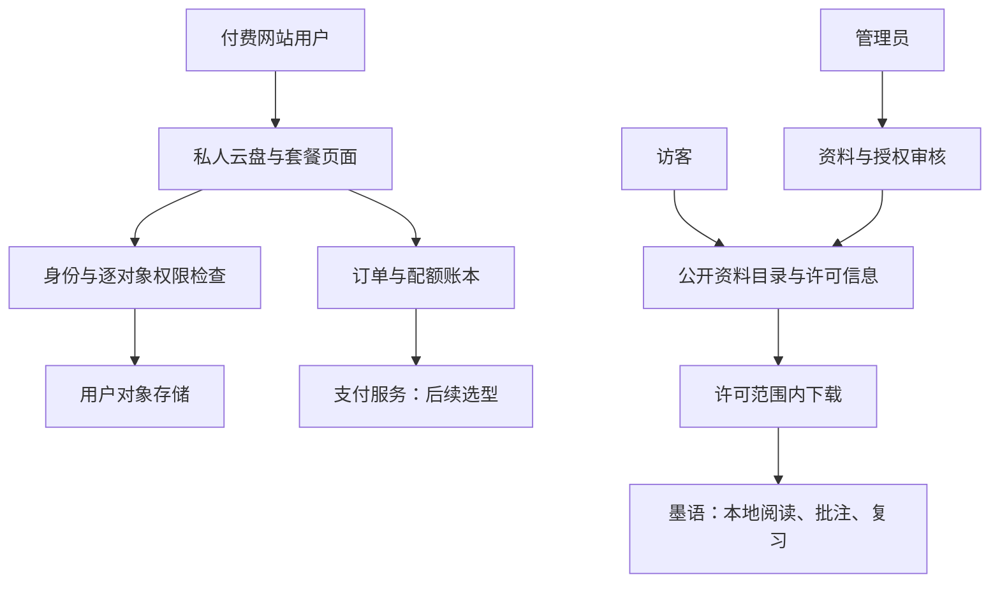

# 收费云盘网站与公开资料库建设方案

更新：2026-10-22。状态为下一阶段商业与技术方案，网站、账号、存储、检索、支付、云AI和客户端连接均未实现。

## 产品结构

网站定位为“发现、管理和处理学习资料的入口”，鸿蒙应用定位为“深入阅读、批注和复习的工作台”。商业主线采用**免费公开资料库＋付费私人空间＋可独立购买的托管云AI服务**，云AI不再仅是自带密钥工具，详见[云AI商业方案](CLOUD_AI_BUSINESS.md)。

| 空间 | 访问与数据 | 用户价值 | 收入方式／状态 |
| --- | --- | --- | --- |
| 公开资料库 | 访客可浏览许可明确的自有／授权资料、目录、说明和标签 | 找到可合法使用的学习资源，快速预览 | 基础浏览和允许的下载免费，先验证需求 |
| 私人免费空间 | 网站账号下的小容量个人目录，容量待测试 | 体验资料上传与整理 | 免费试用额度，未推出 |
| 私人付费云盘 | 网站账号、配额、用量、续费与导出 | 更大容量、稳定管理与备份、跨设备取用 | 存储／流量套餐或年包，未定价上线 |
| 授权内容专题 | 作者或机构明确许可的内容与页面 | 提供经过筛选且有来源的资料 | 仅在获得商业分发授权后评估单独收费，不混同存储费 |
| 托管云AI服务 | 针对用户确认的所选片段，团队提供模型调用和用量管理 | 摘要、带出处问答、题卡候选 | 套餐点数、加量包和机构服务；未实现，可独立于云盘购买 |

公开库与私人库使用不同权限域。私人资料不因会员到期、分享链接或标签变更自动公开；公开资料下架不删除用户自己的原件。付费容量不包含对第三方内容版权的购买。

## 三条用户路径

1. **访客发现资料**：首页／搜索 → 主题页 → 资料详情（来源、作者、许可、版本、大小、格式）→ 在线预览／授权范围内下载 → 用户主动导入墨语。第一阶段通过普通文件下载导入衔接，不承诺未实现的“一键进应用”。
2. **个人购买空间**：账号 → 免费试传 → 看到当前容量和流量 → 选择套餐及明确价格 → 支付确认 → 配额生效 → 上传、下载、整理和导出。付费网站身份独立，应用基础阅读不强制登录。
3. **贡献公开资料**：登录 → 提交资料、来源和授权声明 → 管理员核对 → 预览后公开 → 提供反馈入口。第一版先由管理员上架自有／授权资料，再评估开放投稿，避免先建设不可维护的内容社区。

## 免费和付费边界

公开资料库不以付费墙遮挡来源、授权和基本介绍。私人套餐清楚展示总容量、单文件上限、月下行额度、超额行为、有效期与到期导出方式；首版优先明确年包或一次购买固定期限，不先默认自动续费。未支付、回调失败或订单处理中不能提前授予容量。

到期后的保留期、只读期和清理规则在开售前写明并在购买页展示。拟采用“超额后暂停新上传，保留读取与导出窗口”的产品方向，具体天数、退款和续费政策必须在实际运营准备完成后确定，不先承诺永久保管。

以下仅用于需求访谈的报价卡，**不是实际售价或市场行情**：

| 研究用套餐 | 假设权益 | 假设价格 | 要验证的问题 |
| --- | --- | --- | --- |
| 体验 | 1 GB，月下行2 GB | 免费 | 是否能让用户完成首次资料整理 |
| 学习 | 20 GB，月下行20 GB | 59元／年 | 容量是否足够、是否愿意为稳定取用付费 |
| 进阶 | 100 GB，月下行100 GB | 149元／年 | 课本大文件与下载频率会不会突破成本 |

不承诺不限速、无限空间或永久有效；存储可靠性、带宽、备份和售后能力必须先实测，再确定对外服务承诺。

## 网站页面和服务模块

| 模块 | 第一阶段最小范围 | 后续扩展 |
| --- | --- | --- |
| 公共首页／资料库 | 分类、标签、关键词、详情与静态预览；初期管理员维护 | 高级筛选、专题、作者页 |
| 私人文件区 | 文件夹、上传、下载、移动、重命名、回收站、容量统计 | 版本历史、分块上传、桌面整理 |
| 账号与权限 | 仅网站需要的身份、会话、私有对象授权 | 设备管理与客户端可选连接 |
| 套餐与订单 | 套餐说明、订单、支付结果、配额记录、用量 | 发票／退款流程等按真实运营需要实现 |
| AI工作区 | 所选资料、任务状态、原文引用、结果采纳、点数用量 | 多资料问答、题卡批次与机构资料域 |
| 管理台 | 资料发布／撤回、授权记录、投诉处理、配额核对、操作审计 | 投稿审核队列与更细分角色 |
| 运维 | 备份恢复、费用告警、对象清理、服务状态 | 多区域或容灾，仅按需要建设 |

内部页面不能暴露对象存储主密钥；上传／下载通过短时、限对象、限权限的授权访问。公开库若无需在线执行原文件，优先提供安全预览或下载；用户文件名和压缩包路径不作为服务器路径直接使用。

## 数据和架构边界



建议核心模型：`User`、`FileObject`、`Folder`、`QuotaLedger`、`Plan`、`Order`、`PaymentEvent`、`PublicResource`、`LicenseRecord`、`Report`、`AuditEvent`。对象 ID 使用不可猜测标识，但不可猜测本身不能代替权限检查；每个私有读写都验证所有权。

订单、支付回调与配额分录采用幂等处理，同一事件只能记账一次。回调需验签并向支付服务核对状态，不能根据前端“支付成功”按钮发放容量。并发上传先预留额度、成功后结算、失败释放，防止绕过配额。对象写入与数据库登记分步骤，须有补偿和孤立对象清理任务。

**网站私有云盘的安全方案需明确两种服务能力：**

- 与墨语衔接的加密副本：设备端加密后上传，网站存密文；网站不能全文检索或直接预览正文，密钥恢复由用户控制。
- 普通网页上传及在线预览：服务需处理用户文件明文，按账号权限隔离；传输加密和存储加密不等于端到端加密。若提供该模式，购买／上传页与隐私说明需明确数据处理范围。

第一版优先选择一条私人存储路径并完成验收，不混用宣传；公开资料库本来就是经授权可公开内容，不能宣称其正文只有作者可见。当前客户端继续无账号本地使用，网站账号仅用于可选收费服务。

## 云成本与商业测算

收费云盘的核心变量是实际占用、下载流量和备份，公开库还要承担未付费访问成本。存储服务有请求、流量等独立费用，预算须覆盖这些项目。[华为云 OBS 计费概述](https://support.huaweicloud.com/intl/zh-cn/price-obs/obs_42_0001.html)。

```text
月度成本 = (私人实际存储 + 公开库存储 + 备份存储) × 每GB月单价
         + 月下行流量 × 每GB单价 + 请求／取回／处理费用
         + 网站计算与数据库 + 支付费用 + 人工支持 + 其他实际成本
```

算术场景假设：100位年付59元用户，平均实际占用5 GB，公开库50 GB，另保留一份完整备份，总计1100 GB；总下行1000 GB／月。若假设存储0.10元／GB月、下行0.50元／GB、网站固定成本100元／月，则这三项月成本为 **710元**，月均收入为 **491.67元**，尚未计算请求、支付和人工，差额为 **-218.33元**。所有单价均为内部假设，非云商报价。

若总下行降至200 GB，同三项成本为310元，差额为181.67元，仍未扣其余成本。说明不能只按空间定价，必须控制合理流量、测量实际占用与公开库下载成本。年费折算不代表月度实际到账；备份副本和年费长期服务责任也不能忽略。

上线前至少做低／中／高流量和满额占用压力测算，再决定套餐是否可持续。公开库单独设月预算与异常流量告警，必要时限流；不把平台费用隐藏转嫁给不知情用户。

## 公开资料的运营规则

每条资料显示来源、作者、许可范围、是否允许下载／商用／改编、版本、反馈入口；缺授权记录不公开文件。可先用原创模板、作者投稿授权内容和许可明确的开放资料，不自动抓取付费云盘、课程平台或第三方课本作为库内容。

提供报告和撤回流程，记录处理人、时间和处置结果；在核对期间可暂停相关公开下载。搜索结果不得泄露私人目录、文件名或内容。公开状态、下载权限与私人分享链接分开维护。正式运营涉及的发布身份和相关要求由负责人按服务地区与实际范围核验，本方案不将文档准备当作已具备运营资格。

## 产品演进

| 阶段 | 功能方向 | 验证重点 |
| --- | --- | --- |
| W0 方案验证 | 5–10条自有／授权资料的目录原型、报价卡和访谈 | 来源清楚、完成发现→下载→本地阅读任务；数字是计划非已完成 |
| W1 公开库 | 公共目录、详情、许可、下载与管理台 | 公开与私人无串读，来源可核对，撤回和费用告警可用 |
| W2 私人付费空间 | 账号、文件管理、订单、配额、备份恢复、清晰政策 | 支付幂等、越权拒绝、并发配额、到期导出、故障恢复和成本均通过 |
| W3 应用可选连接 | 选定存储模式、设备凭据、资料引用和失败重试 | 数据边界、手机／平板交互与基础离线使用 |
| W4 托管云AI，可独立推进 | 所选片段推理、来源引用、人工采纳、套餐点数和计量 | 按[云AI方案](CLOUD_AI_DESIGN.md)单独验证与核算，不依赖先购买云盘 |

在商业与创新材料中明确展示网站和云AI的方案状态、用户价值与验证计划，不把域名、截图或规划当成已运营收费业务。具体比赛交付和市场操作保留在本地文档。
